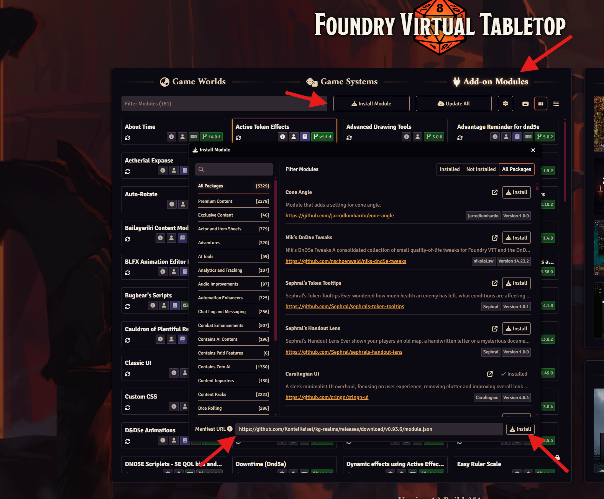
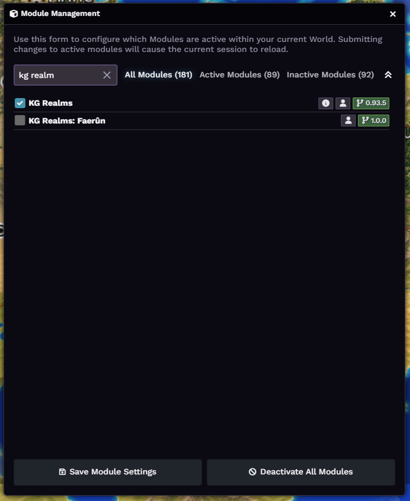
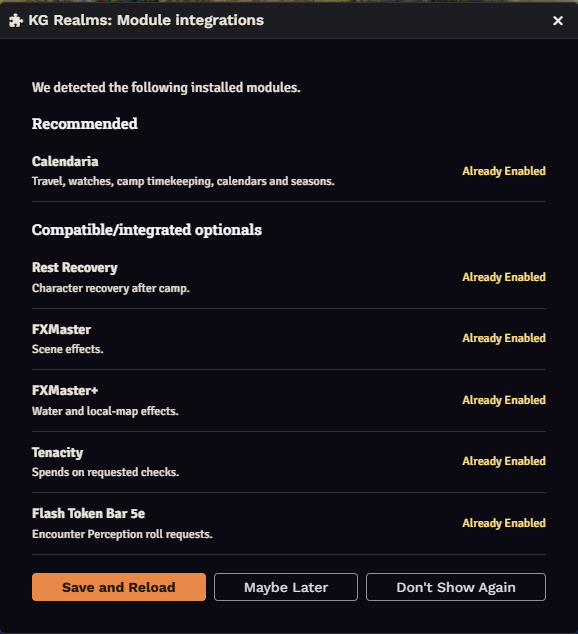

# Install KG Realms

Audience: GM. Required: a Foundry game world using D&D 5e.

## Version support

The 0.93.13 manifest declares Foundry 13.351 or later, verified on generation 13, with generation 14 as the maximum. Module features use D&D 5e actors, groups, skills and vehicles.

## Install the engine

1. In Foundry Setup, open Add-on Modules > Install Module.
2. Paste this link into Manifest URL:

```text
https://github.com/KonteiKeisei/kg-realms/releases/latest/download/module.json
```

3. Click Install beside Manifest URL.



## Enable it in the game world

1. Launch your game world.
2. Open Game Settings > Manage Modules.
3. Type kg realm in the filter field.
4. Tick the checkbox beside KG Realms.
5. Click Save Module Settings.



The screenshot shows the engine enabled and a companion disabled. Tick the companion for your map too. Leave it disabled if making your own map without that companion.

## Choose the map source

KG Realms is the engine. It does not include a complete realm.

- Companion module: supplies a registered realm and its packaged content. Install and enable both modules.
- Your own image: convert a scene background into a realm. Add places, roads and other map data yourself.

See [Set up a realm](02-realm.md).

## First-load module check

Calendaria is recommended for travel, watches and camp timekeeping. The other integrations are compatible/integrated optionals.

On the first GM load, KG Realms offers setup if an installed integration is disabled and can be enabled. If everything installed is already enabled, no prompt appears. Active modules show Already Enabled. Tick any inactive modules you want to enable.

| Button | Result |
| --- | --- |
| Save and Reload | Enables your selections and their required modules, saves, then reloads connected clients |
| Maybe Later | Leaves modules unchanged and asks again on the next load |
| Don't Show Again | Leaves modules unchanged and stops automatic prompts for this world |

Open Configure Settings > KG Realms > Module integrations > Review integrations to review the list later.



This screenshot shows all integrations enabled. From 0.93.10, this view is available through Review integrations and does not open automatically.

The prompt does not install modules. See [Reference](17-reference.md#compatibleintegrated-optionals) for integration details.

Next: [Set up a realm map](02-realm.md). [Contents](README.md).
