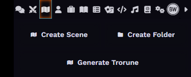

# Set up a realm map

Audience: GM. Required: [KG Realms enabled](01-install.md).

Examples use Trorune. Choose one setup path.

## Use a companion realm module

1. Install the companion module using its supplied manifest or package.
2. Enable it alongside KG Realms in Manage Modules.
3. Reload the game world.
4. Open the Scenes sidebar.
5. Click Generate Trorune. With several realms installed, the button reads Generate world map.

6. Choose a realm if prompted.
7. If a map checklist appears, select the maps to generate and click Generate selected. Parent maps are selected when needed.
8. If the package uses the older realm generator, click Generate scene.
9. Open the created scene from the Scenes sidebar.

Supplied places, roads, trade data and local maps depend on the companion package. The engine does not add missing content from a map picture.

Exported packages use their prepared scenes. Older companion packages may generate a realm scene from registered map data.

## Use an exported realm module

1. Extract the exported module ZIP into Foundry's Data/modules folder.
2. Enable KG Realms and the exported module in Manage Modules, then reload.
3. In the map checklist, select the maps to generate.
4. Review the hierarchy: realm, Regional maps, local maps and linked interiors.
5. Untick Include scene tokens to generate maps without their packaged tokens.
6. Click Generate selected.
7. Open the created realm scene.

Click Generate Trorune in the Scenes sidebar to reopen the checklist. Unselected maps remain available on their place cards through Generate followed by the place name. Existing scenes keep their edits. Regional links are restored when the linked scenes exist.

The Scenes compendium remains available. Importing its prepared realm scene also opens the checklist for the remaining maps.

## Use your own map image

1. Create a Foundry scene.
2. Set Background Image to your map picture and save the scene.
3. Right-click the scene in the Scenes sidebar.
4. Select Make realm world.
5. Enter World name.
6. Enter Map width in miles. This is the distance across the entire picture, left edge to right edge.
7. Click Make realm world.
8. Wait for the build to finish, then open the scene.

The conversion backs up the scene and builds compressed map tiles. It does not recognise printed towns, roads, rivers or text. The new realm starts without those editable features.

For example, a picture representing 600 miles across needs 600 in Map width in miles, regardless of its pixel dimensions.

## Build requirements

- Open Foundry over HTTPS or localhost for tile creation.
- Use a still image. Video backgrounds are not accepted by the conversion menu.
- Pictures over 16,384 pixels on a side are reduced for the build. The original picture file is unchanged.
- Generated files are stored under `Data/KG Realms Data/World/<world id>/`.
- Large pictures can take several minutes to process.

## Check and adjust

1. Open the realm and confirm its artwork loads.
2. For a converted map, right-click its scene and select Realm world settings to check the name and width.
3. For a companion realm, confirm that its supplied places appear with the relevant map filters enabled.
4. Continue to party setup.

A scene backup restores the original scene configuration. It does not replace a backup of your whole Foundry world. See [Backups](15-files.md#back-up-a-custom-realm).

Next: [Prepare the party and map](03-party.md). [Contents](README.md).
